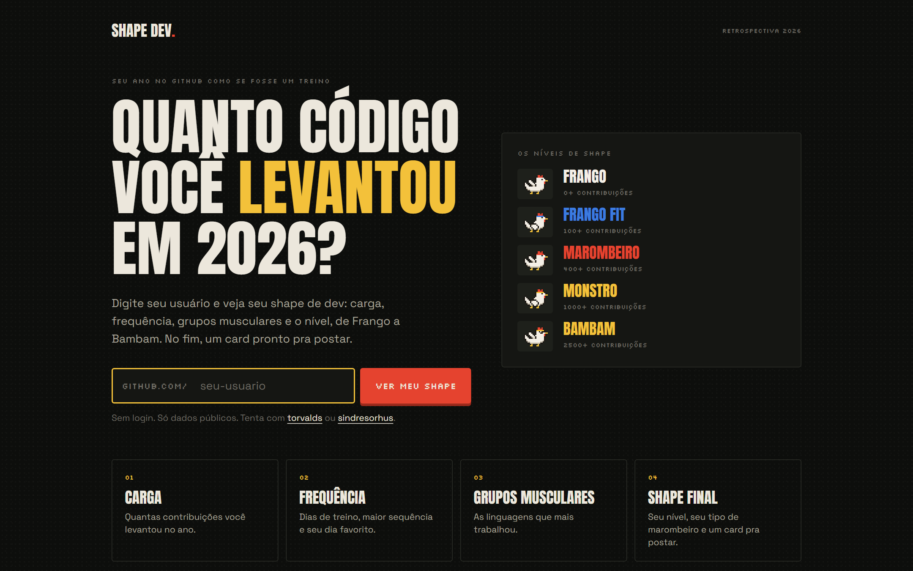
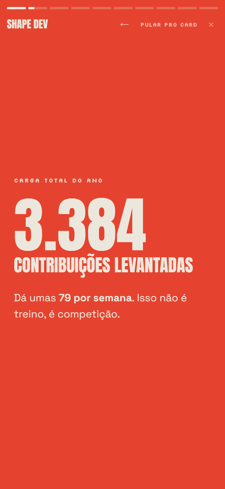
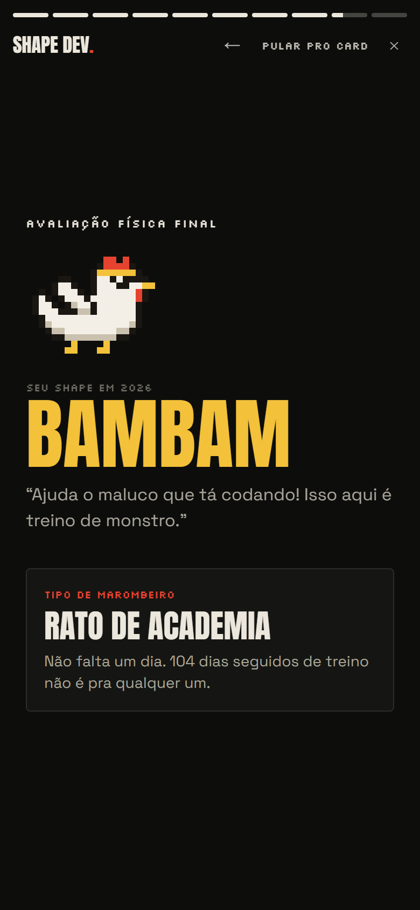
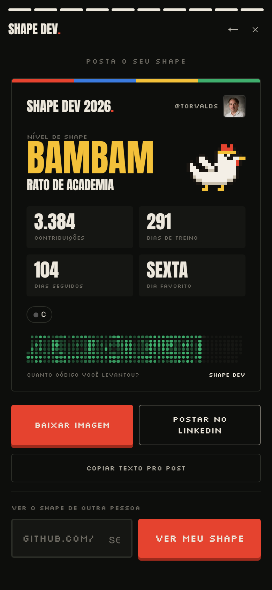
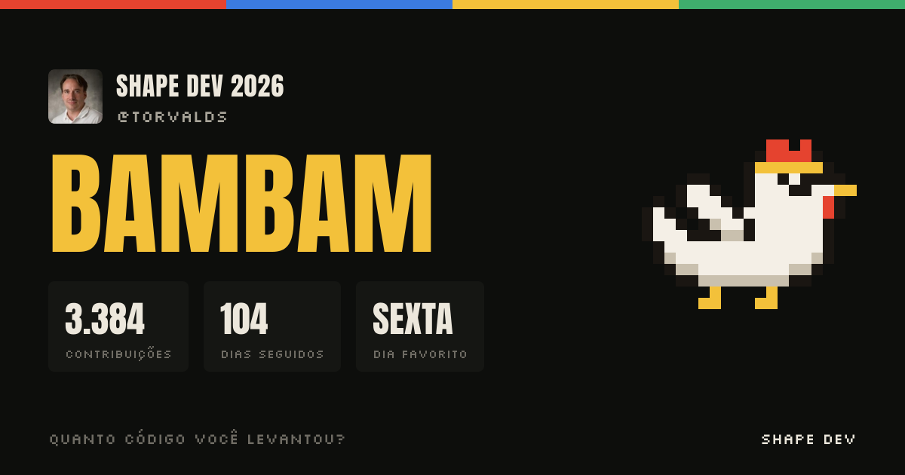

<div align="center">



<br />

[](https://github.com/Bleachless/shape-dev/actions/workflows/ci.yml)


**Seu ano no GitHub como se fosse um treino.**
<br />
Digita o usuário e recebe uma retrospectiva em stories: carga, frequência, grupos musculares e o seu nível de shape, de Frango a Bambam.
<br />
No fim, um card pronto pra postar no LinkedIn.

</div>

---

## 🏋️ Como fica

<table>
  <tr>
    <td align="center"><br /><sub><b>Carga</b><br />contribuições do ano</sub></td>
    <td align="center"><br /><sub><b>Frequência</b><br />dias de treino</sub></td>
    <td align="center"><br /><sub><b>Avaliação final</b><br />nível e arquétipo</sub></td>
    <td align="center"><br /><sub><b>Card</b><br />pra postar</sub></td>
  </tr>
</table>

O card baixado sai em **1080×1350**, o formato que fica bom no feed do LinkedIn e do Instagram. E o link de cada perfil gera sua própria **imagem de prévia**, então quando alguém posta o link, o shape já aparece no post:



<sub>Exemplos gerados com o perfil público de @torvalds.</sub>

## 📊 O que entra na conta

| Slide | De onde vem |
| --- | --- |
| **Carga total** | Contribuições do ano no calendário público do perfil |
| **Frequência** | Dias com pelo menos uma contribuição, e o mapa do ano |
| **Sem faltar um dia** | Maior sequência de dias seguidos e a sequência atual |
| **Dia de treino** | Dia da semana com mais contribuições, o dia mais pesado e o mês mais forte |
| **Grupos musculares** | Linguagens dos repositórios mexidos no ano |
| **Horário do treino** | Horário dos pushes públicos recentes, no fuso de Brasília |
| **Exercício favorito** | Repositório mais estrelado entre os mexidos no ano |
| **Avaliação final** | Nível de shape e tipo de marombeiro |

### Níveis de shape

| Nível | Contribuições no ano |
| --- | --- |
| 🐔 Frango | 0+ |
| 🐔 Frango Fit | 100+ |
| 🐔 Marombeiro | 400+ |
| 🐔 Monstro | 1.000+ |
| 🕶️ Bambam | 2.500+ |

E o **tipo de marombeiro** sai do jeito que você treina: Coruja do commit, Treino das 6h, Rato de academia, Atleta de fim de semana, Treino funcional, Explosivo ou Feijão com arroz.

> Contribuições em repositórios privados só aparecem se você ativar *"Include private contributions on my profile"* nas configurações do GitHub.

## ⚙️ Como funciona

- **Sem login e sem banco de dados.** Tudo vem de dados públicos do GitHub, buscados no servidor com cache de 1 hora.
- O **calendário de contribuições** é lido da página pública do perfil, que não gasta o limite da API. Perfil, repositórios e eventos vêm da API REST.
- Sem token, a API permite 60 consultas por hora. Com a variável `GITHUB_TOKEN` (um token pessoal sem nenhuma permissão extra), são 5.000. Se o limite estourar, o app continua mostrando o calendário e avisa que linguagens e repositórios podem faltar.
- O **card** vira imagem no próprio navegador com `html-to-image`, e a **prévia dos links** é gerada sob demanda com `next/og`.
- Todas as contas ficam em funções puras em [`src/lib/stats.ts`](src/lib/stats.ts), cobertas por testes.

## 🚀 Rodar localmente

```bash
git clone https://github.com/Bleachless/shape-dev.git
cd shape-dev
npm install
npm run dev
```

Abra http://localhost:3000/torvalds, ou qualquer usuário do GitHub.

```bash
npm test          # testes das estatísticas e do leitor do calendário
```

## 🌐 Publicar

Na Vercel: **Add New → Project**, importe o repositório e faça o deploy. Depois, em **Settings → Environment Variables**:

| Variável | Para quê |
| --- | --- |
| `NEXT_PUBLIC_SITE_URL` | O endereço do site (ex.: `https://shapedev.vercel.app`), usado nas imagens de prévia |
| `GITHUB_TOKEN` | Opcional, aumenta o limite da API para 5.000 consultas por hora |

---

<div align="center">

Feito por **[João Vaz](https://github.com/Bleachless)**.
<br />
O Frango também treina no **[Frango Fit](https://github.com/Bleachless/frango-fit)** 🐔

</div>
